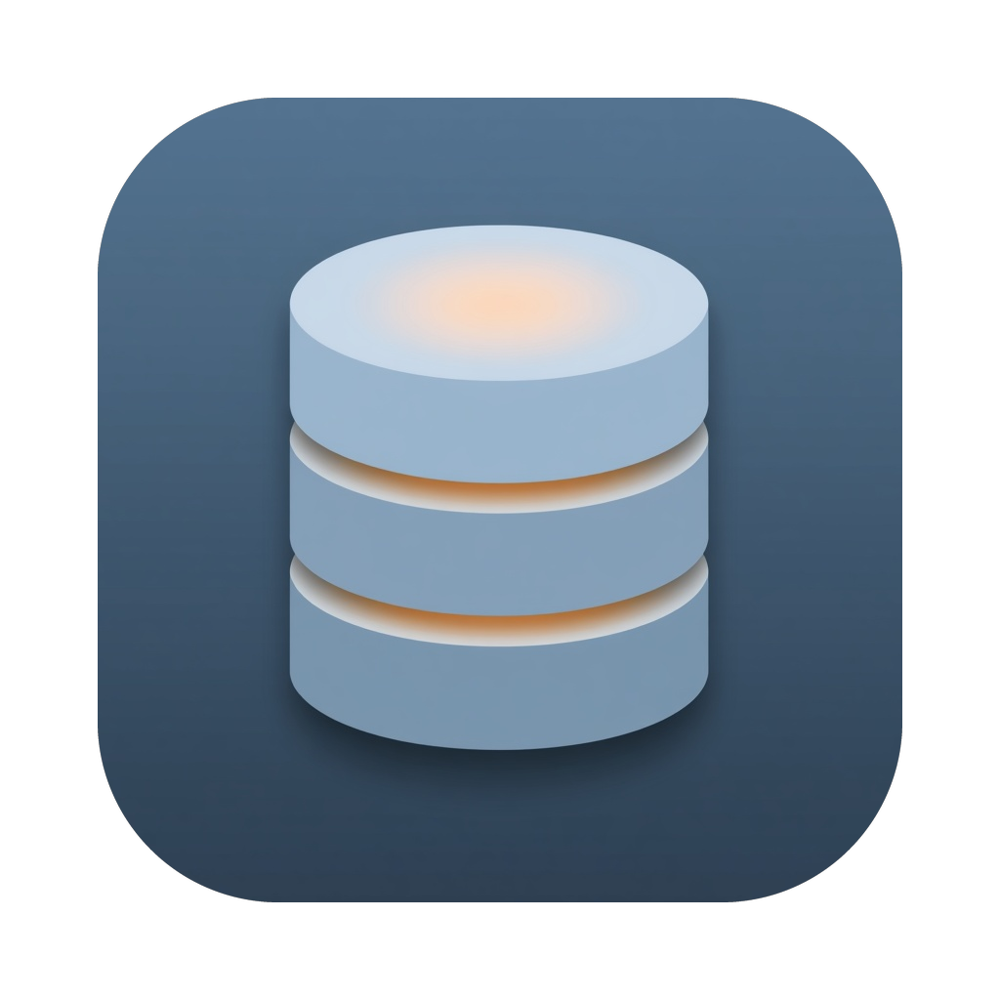
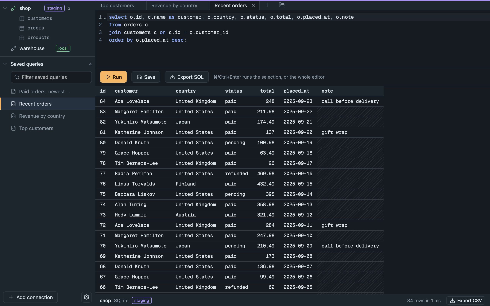
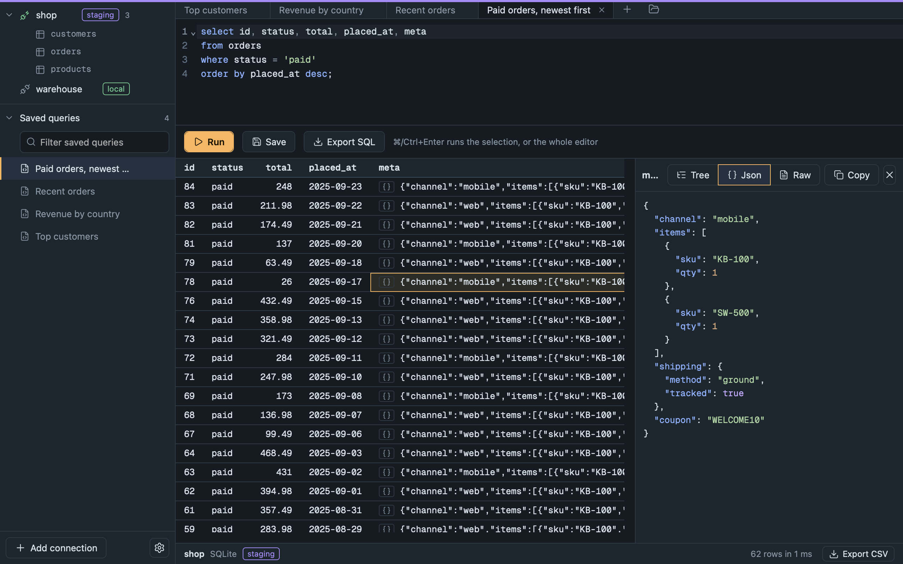
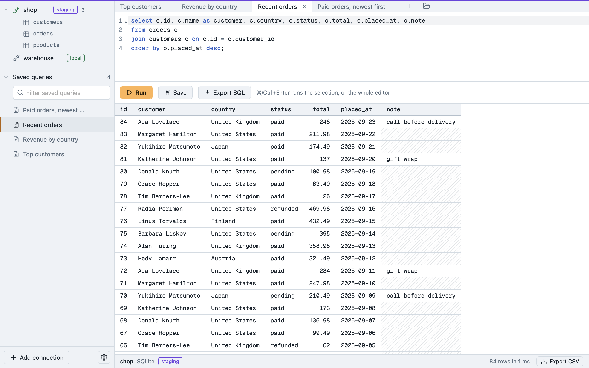

<p align="center">
  
</p>

<h1 align="center">TinyArQL</h1>

<p align="center">
  <strong>A tiny, fast SQL client for PostgreSQL, MySQL and SQLite.</strong><br>
  An 8 MB download. No Electron, no Java, no database drivers to install.
</p>

<p align="center">
  <a href="https://github.com/RomAnoX/tinyarql/releases/latest"></a>
  <a href="LICENSE"></a>
  
</p>

<p align="center">
  
</p>

## Why TinyArQL

Most database clients are heavy. TinyArQL is built on [tinyjs](https://tinyjs.app), which pairs a small JavaScript runtime with the operating system's own web view, so the whole app is a few megabytes and starts instantly.

It started as a rebuild of Arctype, a lovely SQL client that is no longer maintained, and shares no code with it. The database drivers are written in plain JavaScript against each database's wire protocol, so there is nothing else to install.

- **Small and quick.** An 8 MB download that opens in a moment.
- **Safe by design.** Passwords live in your system keychain, never in a file. Connections can be tagged `local`, `staging` or `production`, and while you are connected the window gets a coloured edge, so you can tell at a glance which database you are talking to.
- **Calm to look at.** A cool slate palette with one amber accent, in light and dark, following your system by default.

## Features

### Write and run SQL
- A real editor ([CodeMirror 6](https://codemirror.net)) with syntax highlighting for each database's dialect, and **completion for table and column names** from the live schema.
- **⌘↵** runs the selection, or the whole editor. Run a script of several statements and you get the last result.
- **Stop a running query** with ⌘. (PostgreSQL and MySQL).
- Optional **Vim keybindings**, including `:w` to run.

### Work in tabs
- **Query tabs** that keep their own SQL, results, undo history and connection. Drag them to reorder, or use Alt + ← / →.
- Everything is **restored when you reopen the app**: tabs, SQL, layout, theme and window position.
- **Saved queries** in a searchable library, **open `.sql` files** (or drop them on the window), and **export** any tab to a `.sql` file.

### Look at your data
- Typed result columns: numbers right-aligned, `NULL` clearly marked, and the column type shown under its name.
- **Browse tables** page by page, without writing a query.
- Click any cell for a **detail panel**, and open JSON columns as a collapsible tree, as indented and coloured JSON, or as the raw text exactly as the database returned it.
- **Export results to CSV.** For big results it re-runs the query and streams every row straight to disk, so you are not limited to what fits on screen, and you can stop it part-way.

<p align="center">
  
</p>

### Connect anywhere
- **PostgreSQL** (password, md5 and SCRAM-SHA-256 logins), **MySQL** (both `caching_sha2_password` and `mysql_native_password`), and **SQLite** files.
- **TLS** for PostgreSQL and MySQL, including cloud databases that require it. The certificate is always verified.
- **SSH tunnels** for remote databases, using your keys or ssh-agent.
- Test a connection from the form before you save it.

<p align="center">
  
</p>

## Install

1. Download **`TinyArQL-<version>-macOS-universal.dmg`** from the [latest release](https://github.com/RomAnoX/tinyarql/releases/latest).
2. Open it and drag **TinyArQL** onto **Applications**.
3. The first time you open it, macOS will say it can't verify the app. That's expected: this build is signed ad hoc and not yet notarized by Apple. To allow it:
   - Open **System Settings → Privacy & Security**, scroll down, and click **Open Anyway** next to TinyArQL, or
   - run `xattr -dr com.apple.quarantine /Applications/TinyArQL.app` in Terminal.

Requires macOS 15 or later. The download is a universal build for Intel and Apple Silicon Macs. Each release also lists a SHA-256 checksum for the installer.

## Keyboard shortcuts

| Shortcut | Action |
| --- | --- |
| ⌘ ↵ | Run the selection, or the whole editor |
| ⌘ . | Stop the running query |
| ⌘ T | New tab |
| Ctrl Tab / Ctrl ⇧ Tab | Next / previous tab |
| Alt ← / Alt → | Move the focused tab |
| ⌘ S / ⌘ ⇧ S | Save the query / save a copy |
| ⌘ O | Open `.sql` files |
| ⌘ E | Export the query as `.sql` |
| ⌘ ⇧ E | Export the results as CSV |
| ⌘ , | Settings |

## Good to know

- **TLS verifies the certificate by default.** For a private or self-signed certificate, choose its CA's `.pem` file in the connection settings. There is also a **Don't verify the certificate** option (encrypts, but cannot tell the real server from an impostor): it needs the `openssl` command (always present on macOS) and works for self-signed certificates, not expired ones. MySQL's auto-generated certificates carry no host name, so use that option for them or give the server a proper certificate.
- **MySQL** has been tested against MySQL 8.0 only. MariaDB and MySQL 5.7 should work with the standard login but are untested.
- **SQLite queries can't be stopped** once started, because the SQLite library is synchronous.
- **macOS first.** It is built and tested on macOS. tinyjs can target Windows and Linux, but this has not been tried there.
- The Apple Silicon half of the universal build has not been run on real Apple Silicon hardware yet. Reports are welcome.

This is an early release, so expect rough edges. Please [open an issue](https://github.com/RomAnoX/tinyarql/issues) if you find one.

## Build from source

You need the [tinyjs](https://tinyjs.app) command-line tool.

```sh
tinyjs dev                          # run with hot reload
tinyjs build --universal --dmg      # build TinyArQL.app and a DMG installer into dist/
```

The editor and the icons are pre-built into `src/frontend/`, so there is no build step to run the app. To change them:

```sh
cd tools/editor
npm install
npm run build     # CodeMirror bundle   -> src/frontend/editor.js
npm run icons     # Lucide icon set     -> src/frontend/icons.js
```

The app icon comes from `icon.png`; `python3 tools/make-icon.py some-image.jpg` turns any square image into one in the shape tinyjs expects.

### Tests

The tests live in `test/`. The database tests need disposable servers, and the header of each file says what it expects.

```sh
~/.tinyjs/bin/tjs run test/md5.js           # MD5 (no services needed)
~/.tinyjs/bin/tjs run test/csv.js           # CSV format and file writer (no services needed)
~/.tinyjs/bin/tjs run test/windowstate.js   # window position rules (no services needed)
test/postgres-server.sh start               # a throwaway PostgreSQL (uses one you have installed)
test/mysql-server.sh start                  # a throwaway MySQL 8 (downloads it once)
~/.tinyjs/bin/tjs run test/drivers.js       # PostgreSQL, MySQL and SQLite drivers
~/.tinyjs/bin/tjs run test/main.js          # the backend API, end to end
~/.tinyjs/bin/tjs run test/tls.js           # TLS to PostgreSQL and MySQL servers that require it
test/ui.sh                                  # the interface, driven in a real window (macOS)
```

## Credits

TinyArQL stands on the shoulders of [tinyjs](https://tinyjs.app) and [txiki.js](https://github.com/saghul/txiki.js), [CodeMirror 6](https://codemirror.net), [@replit/codemirror-vim](https://github.com/replit/codemirror-vim), [Lucide](https://lucide.dev) icons and the [Geist Mono](https://vercel.com/font) typeface. See [THIRD-PARTY-NOTICES.md](THIRD-PARTY-NOTICES.md).

## License

[MIT](LICENSE)
